

  <picture><source media="(prefers-color-scheme: dark)" srcset="https://raw.githubusercontent.com/molexxxx/molexxxx/main/.github/badges/tag-developer-dark.svg?v=0934c046"></picture>
  <picture><source media="(prefers-color-scheme: dark)" srcset="https://raw.githubusercontent.com/molexxxx/molexxxx/main/.github/badges/tag-web-dark.svg?v=6a8a4dd7"></picture>
  <picture><source media="(prefers-color-scheme: dark)" srcset="https://raw.githubusercontent.com/molexxxx/molexxxx/main/.github/badges/tag-desktop-dark.svg?v=f027742e"></picture>
  <picture><source media="(prefers-color-scheme: dark)" srcset="https://raw.githubusercontent.com/molexxxx/molexxxx/main/.github/badges/tag-games-dark.svg?v=deac1fbc"></picture>
  <picture><source media="(prefers-color-scheme: dark)" srcset="https://raw.githubusercontent.com/molexxxx/molexxxx/main/.github/badges/tag-robotics-drones-dark.svg?v=4271e347"></picture>
  <picture><source media="(prefers-color-scheme: dark)" srcset="https://raw.githubusercontent.com/molexxxx/molexxxx/main/.github/badges/tag-real-time-dark.svg?v=e358f8dc"></picture>
  <picture><source media="(prefers-color-scheme: dark)" srcset="https://raw.githubusercontent.com/molexxxx/molexxxx/main/.github/badges/tag-audio-dsp-dark.svg?v=41604a40"></picture>
  <picture><source media="(prefers-color-scheme: dark)" srcset="https://raw.githubusercontent.com/molexxxx/molexxxx/main/.github/badges/tag-graphics-dark.svg?v=2ce2e73c"></picture>

  <a href="https://www.npmjs.com/~molex222"><picture><source media="(prefers-color-scheme: dark)" srcset="https://raw.githubusercontent.com/molexxxx/molexxxx/main/.github/badges/header-npm-dark.svg?v=200430c1"></picture></a>
  <a href="https://crates.io/users/tonywied17"><picture><source media="(prefers-color-scheme: dark)" srcset="https://raw.githubusercontent.com/molexxxx/molexxxx/main/.github/badges/header-crates-dark.svg?v=c32a466e"></picture></a>
  <a href="https://www.nuget.org/profiles/tonywied17"><picture><source media="(prefers-color-scheme: dark)" srcset="https://raw.githubusercontent.com/molexxxx/molexxxx/main/.github/badges/header-nuget-dark.svg?v=c24d7feb"></picture></a>
  <a href="https://pypi.org/user/tonywied17/"><picture><source media="(prefers-color-scheme: dark)" srcset="https://raw.githubusercontent.com/molexxxx/molexxxx/main/.github/badges/header-pypi-dark.svg?v=6d9bd9e2"></picture></a>

<!-- activity:start -->
  <picture><source media="(prefers-color-scheme: dark)" srcset="https://raw.githubusercontent.com/molexxxx/molexxxx/main/.github/badges/activity-contributions-dark.svg?v=eafd136f"></picture> <picture><source media="(prefers-color-scheme: dark)" srcset="https://raw.githubusercontent.com/molexxxx/molexxxx/main/.github/badges/activity-stats-dark.svg?v=a700677f"></picture>
<!-- activity:end -->

### Libraries

<!-- projects:libraries -->

  <a href="https://github.com/molexxxx/pamoja"><picture><source media="(prefers-color-scheme: dark)" srcset="https://raw.githubusercontent.com/molexxxx/molexxxx/main/.github/badges/card-pamoja-dark.svg?v=c791ced2"></picture></a>
  <a href="https://github.com/molexxxx/zerolith"><picture><source media="(prefers-color-scheme: dark)" srcset="https://raw.githubusercontent.com/molexxxx/molexxxx/main/.github/badges/card-zerolith-dark.svg?v=44e7f5e7"></picture></a>
  <a href="https://github.com/molexxxx/zero-server"><picture><source media="(prefers-color-scheme: dark)" srcset="https://raw.githubusercontent.com/molexxxx/molexxxx/main/.github/badges/card-zero-server-dark.svg?v=dfad1f3e"></picture></a>
  <a href="https://github.com/molexxxx/zero-transfer"><picture><source media="(prefers-color-scheme: dark)" srcset="https://raw.githubusercontent.com/molexxxx/molexxxx/main/.github/badges/card-zero-transfer-dark.svg?v=cbdee100"></picture></a>

<!-- /projects:libraries -->

### Applications

<!-- projects:applications -->

  <a href="https://github.com/molexxxx/wortool-desktop"><picture><source media="(prefers-color-scheme: dark)" srcset="https://raw.githubusercontent.com/molexxxx/molexxxx/main/.github/badges/card-wortool-desktop-dark.svg?v=c81906d7"></picture></a>
  <a href="https://github.com/molexxxx/youtube-downloader"><picture><source media="(prefers-color-scheme: dark)" srcset="https://raw.githubusercontent.com/molexxxx/molexxxx/main/.github/badges/card-youtube-downloader-dark.svg?v=daff1ff3"></picture></a>
  <a href="https://github.com/molexxxx/plex-poster-set-helper-2"><picture><source media="(prefers-color-scheme: dark)" srcset="https://raw.githubusercontent.com/molexxxx/molexxxx/main/.github/badges/card-plex-poster-helper-2-dark.svg?v=56dd31d1"></picture></a>
  <a href="https://github.com/molexxxx/molex-media-toolkit"><picture><source media="(prefers-color-scheme: dark)" srcset="https://raw.githubusercontent.com/molexxxx/molexxxx/main/.github/badges/card-molex-media-dark.svg?v=17bff4c0"></picture></a>
  <a href="https://github.com/molexxxx/MagnifyShit-cpp"><picture><source media="(prefers-color-scheme: dark)" srcset="https://raw.githubusercontent.com/molexxxx/molexxxx/main/.github/badges/card-magnifyshit-dark.svg?v=088de045"></picture></a>

<!-- /projects:applications -->

### Maintenance

<!-- projects:maintenance -->

  <a href="https://github.com/molexxxx/zero-query"><picture><source media="(prefers-color-scheme: dark)" srcset="https://raw.githubusercontent.com/molexxxx/molexxxx/main/.github/badges/card-zero-query-dark.svg?v=a15907fc"></picture></a>
  <a href="https://github.com/molexxxx/zero-server-node"><picture><source media="(prefers-color-scheme: dark)" srcset="https://raw.githubusercontent.com/molexxxx/molexxxx/main/.github/badges/card-zero-server-node-dark.svg?v=ed9106fe"></picture></a>

<!-- /projects:maintenance -->

### Stack

<!-- stack:start -->
<picture><source media="(prefers-color-scheme: dark)" srcset="https://raw.githubusercontent.com/molexxxx/molexxxx/main/.github/badges/stack-languages-dark.svg?v=bc0d149b"></picture> <picture><source media="(prefers-color-scheme: dark)" srcset="https://raw.githubusercontent.com/molexxxx/molexxxx/main/.github/badges/stack-backend-dark.svg?v=049bc957"></picture> 
  <picture><source media="(prefers-color-scheme: dark)" srcset="https://raw.githubusercontent.com/molexxxx/molexxxx/main/.github/badges/stack-frontend-and-desktop-dark.svg?v=624c96e5"></picture> <picture><source media="(prefers-color-scheme: dark)" srcset="https://raw.githubusercontent.com/molexxxx/molexxxx/main/.github/badges/stack-data-dark.svg?v=d8417b35"></picture> 
  <picture><source media="(prefers-color-scheme: dark)" srcset="https://raw.githubusercontent.com/molexxxx/molexxxx/main/.github/badges/stack-real-time-and-iot-dark.svg?v=9889c7a4"></picture> <picture><source media="(prefers-color-scheme: dark)" srcset="https://raw.githubusercontent.com/molexxxx/molexxxx/main/.github/badges/stack-infrastructure-dark.svg?v=805aa090"></picture> 
  <picture><source media="(prefers-color-scheme: dark)" srcset="https://raw.githubusercontent.com/molexxxx/molexxxx/main/.github/badges/stack-robotics-and-drones-dark.svg?v=7200d0c0"></picture> <picture><source media="(prefers-color-scheme: dark)" srcset="https://raw.githubusercontent.com/molexxxx/molexxxx/main/.github/badges/stack-audio-graphics-and-games-dark.svg?v=d64de497"></picture>
<!-- stack:end -->
